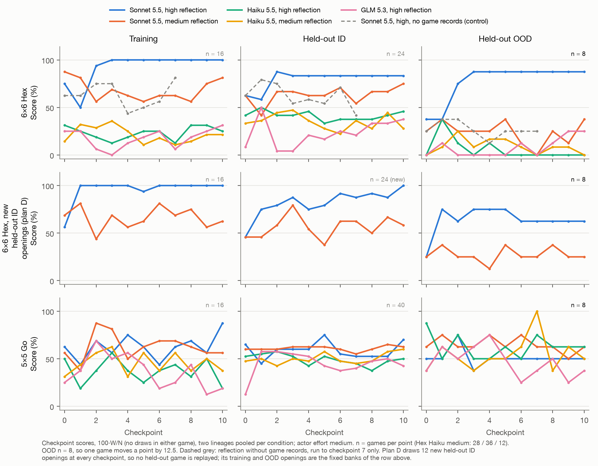
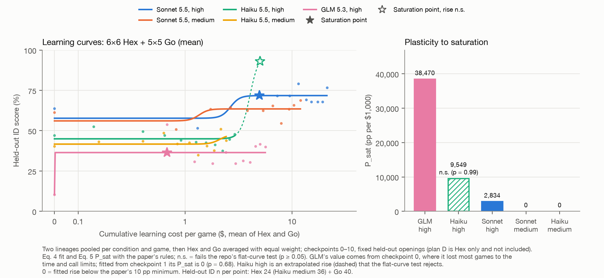

# Agent Plasticity: reproduction and limitation tests



This code tries to reproduce the October 2026 paper
[Agent Plasticity: Measuring Self-Improvement Through Experience](https://arxiv.org/abs/2610.08902)
(Singh et al., Meta Superintelligence Labs / UC Berkeley), at small scale, on 6×6 Hex and 5×5 Go.

TLDR: they studied self-improvement in a controlled setting where agents amortize
past experience into reusable artifacts that are inherited by future instances. they measured performance on training  at specific checkpoints and held-out environment interactions while accounting for learning cost. 
The whole crux of this paper is that they introduce agent plasticity, the efficiency with which an agent converts 
experience into gains in future held-out performance.

The model's weights stay frozen. It improves only through files it writes after each round of
games (Python tools, notes, tracking files), and the next round's agents inherit them.
**Agent plasticity** is the held-out score gain per $1,000 of learning cost. The authors did not
release code, so the protocol here is rebuilt from the paper's equations (Section 2), settings
(Appendix B) and prompts (Appendix I).

#### run

```
$ uv sync
$ uv run pytest
177 passed in 100.03s (0:01:40)
```

The scripted dry run plays a whole lineage with no API calls
([report 06](reports/06_dry_run.md)):

```
$ uv run python scripts/dry_run_hex.py
```

A real lineage needs an OpenRouter key in `.env`. This is one of the plan D lineages: Sonnet 5.5
on Hex, reflection at effort high, checkpoints 0–10, with held-out openings new at every
checkpoint. It stops before any call once the cap is billed:

```
$ uv run python scripts/run_hex.py --game hex --model anthropic/claude-sonnet-5.5 --effort medium \
    --reflect-effort high --rounds 10 --openings fresh --train 8 --id 12 --ood 4 --workers 4 \
    --cap 12 --name hex_sonnet_high_fresh --yes
6x6 Hex: anthropic/claude-sonnet-5.5 via openrouter, effort medium (reflection high), thinking display summarized, openings fresh
checkpoints 0-10, games per checkpoint {'train': 8, 'id': 12, 'ood': 4}: 264 games + 10 reflections
stops before any call once $12.00 is billed; 4 game(s) at once
checkpoint 0
  checkpoint_000_train_g01_red: finished, score 1
  ...
wrote reports/10_hex_sonnet_high_fresh.md
{
 "billed": 10.5985179,
 "learning_cost": 12.245244,
 "stopped": null
}
```

Held-out ID went from 7/12 at checkpoint 0 to 12/12 at checkpoint 10, and the rise passes the
flat-curve test (p = 0.046, [report](reports/10_hex_sonnet_high_fresh.md)). Every other run and
analysis command is in [section 6 of the technical report](reports/TECHNICAL_REPORT.md#6-reproducing-this).

#### results

Against the paper's findings:

- **Finding 1** (self-improvement depends on model and task): reproduced. Sonnet 5.5 learns on
  Hex only at reflection effort high (held-out ID 72 % → 88 % on new openings, p = 0.015 per
  opening); Haiku 5.5 learns on neither game; no Go condition shows a pooled learning curve.
- **Finding 2** (the best performer is not the most plastic): reproduced in one probe, with one
  Opus 5.5 lineage against Sonnet 5.5 on Hex. In the main runs it shows only through GLM 5.3,
  whose top P_sat comes from a checkpoint 0 where it could not finish its games.



| Lineages (two each) | Model | Reflection effort | Held-out ID, early → late | Report |
|---|---|---|---|---|
| Hex, new openings each checkpoint | Sonnet 5.5 | high | 72 % → **88 %** (p = 0.015 per opening) | [24](reports/24_fresh_openings.md) |
| Hex, new openings each checkpoint | Sonnet 5.5 | medium | 57 % → 56 % (p = 0.91) | [24](reports/24_fresh_openings.md) |
| Hex, fixed openings | Sonnet 5.5 | high | 73 % → 83 % (p = 0.04) | [12](reports/12_comparison.md) |
| Hex, fixed openings | Sonnet 5.5 | medium | 59 % → 65 % (p = 0.32) | [12](reports/12_comparison.md) |
| Hex | Haiku 5.5 | high | 44 % → 40 % | [15](reports/15_model_game_comparison.md) |
| Go | Sonnet 5.5 | high | 57 % → 60 % (p = 0.57; one lineage 75 % → 90 %) | [15](reports/15_model_game_comparison.md) |
| Go | Sonnet 5.5 | medium | 60 % → 61 % | [22](reports/22_go_effort.md) |
| Go | Haiku 5.5 | high | 55 % → 47 % | [15](reports/15_model_game_comparison.md) |

Early → late is checkpoints 0–3 → 4–10 for Hex Sonnet and 0–2 → 3–10 for the rest. The gain
lives in the saved tools (removing the final inventory drops held-out ID from 92 % to about 52 %,
[report 17](reports/17_artifact_ablation.md)), and the tools come from the game records (without
records the reflector builds none, [report 18](reports/18_experience_vs_compute.md)). The
everything-in-one-place read is [FINDINGS.md](FINDINGS.md), including the probes (Finding 2, a
Hex → Go stream with and without shared files); methods and every table are in
[reports/TECHNICAL_REPORT.md](reports/TECHNICAL_REPORT.md).

This is much smaller than the paper: 2 games instead of 4, 3 models plus an Opus probe instead of
8, 11 checkpoints instead of 20, and $2–21 billed per lineage instead of about $1,000–3,000.
Most of the gap to the paper's setup is cost. A lot of the rest is guessing, because many
details are not in the paper (see the open questions below).

#### notes

My notes from the paper ([docs/PROTOCOL_NOTES.md](docs/PROTOCOL_NOTES.md) has all of them):

- agent at checkpoint t = frozen model M + inventory I_t (Python tools, strategies, memory)
- every acting episode starts in a fresh context; only the inventory persists
- reflection: I_{t+1} = U_M(I_t, E_t^train), the same model acts and reflects
    - updates must pass structural and executable checks; a rejected attempt keeps I_t
    - 3 attempts in Go and Hex (6 in chess); rejected attempts count toward cost
- splits: train (seen by reflection), held-out ID (same difficulty), held-out OOD (stronger
  opponent); held-out games never reach reflection
- score: S = 100 (W + 0.5 D) / N; an unfinished game is a loss
- cumulative cost (Eq. 2): train plus reflection dollars before checkpoint t, C_0 = 0
- average plasticity (Eq. 3): (S_T − S_0) / C_T, per $1,000
- saturation fit (Eq. 4): Ŝ(C) = S0 + A C^h / (C^h + C50^h), binomial maximum likelihood
- P_sat (Eq. 5): rise per dollar at the first checkpoint reaching 90 % of the fitted rise
    - P_sat = 0 if 0.9 A < 10 points
    - extrapolate up to 3× the final cost, otherwise report plasticity to date
- budgets: 32 model calls per game and 240 s per tool call for the actor; 50 calls and 300 s per
  Bash call for reflection
- Hex: alpha–beta opponents, 10k–1M nodes (train / ID), 10M (OOD); 40 / 40 / 32 games per checkpoint
- Go: GNU Go levels 5–9 (train / ID), 10 (OOD), komi 9.5, Chinese scoring; 20 / 20 / 12 games

How a lineage runs here:

```
checkpoint t, inventory I_t
 ├─ train games ──► actor (fresh context, sandboxed Bash + Python, 32 calls)
 ├─ held-out ID ──► same, scored only, never shown to reflection
 ├─ held-out OOD ─► same, stronger opponent
 └─ reflection on train games (Bash only, 50 calls)
       └─ validator: tracking schemas + every tool loads ─► I_{t+1}, or keep I_t after 3 rejections
```

**Open questions** (and what this repo assumes):

- The Hex opening banks and the alpha–beta evaluation are not published. Openings here are
  4-ply (red) / 5-ply (blue) from one pooled bank; with the paper's 10/11 plies games lasted
  2–7 actor moves.
- Go openings are not described ("training seeds change per checkpoint"). From the empty board
  GNU Go as Black wins every 5×5 game, so short random openings are used, filtered by GNU Go 10
  ([report 13](reports/13_go_calibration.md)).
- Which program adjudicates dead stones in Go is not named. Assumed GNU Go 3.8's `final_score`.
- The price table behind "fixed undiscounted input/output prices" is not given, and the price
  table alone can reverse a ranking ([report 04](reports/04_pricing_sensitivity.md)).
- The validator is described only as "persistent tool load" smoke checks. Here: tracking
  schemas plus every saved tool must load.
- The restricted Python's import whitelist is not given. Here `import` raises.
- The opponents are deterministic and held-out openings fixed, so once a tool stops changing a
  checkpoint replays the previous one move for move. Is a held-out game a new measurement?
  Assumed not: tests use the opening as the unit, and plan D draws new held-out openings at
  every checkpoint ([report 23](reports/23_repeated_games.md)).
- Engines are Python, so Hex opponents search 3k–100k nodes (train / ID) and 1M (OOD), not the
  paper's 10k–10M; games per checkpoint are 8 / 12 / 4 (Hex) and 8 / 20 / 4 (Go).

#### layout

```
plasticity/   metric code (score, cost, fit, P_sat, bootstrap, pricing)
envs/         6x6 Hex and 5x5 Go rules, opponents (alpha-beta, GNU Go over GTP), opening banks, move diagnostics
harness/      sandbox, game API, inventory validator, prompts, episode, reflection, runner
tests/        pytest suite
scripts/      experiments that write the markdown files in reports/
reports/      results (01–25) and the technical report
docs/         protocol notes, deviations from the paper, figures
data/         opening banks (pooled, contested, fresh held-out)
runs/         run output (git-ignored); the traces are on the Hugging Face dataset
```

Data: every game, reflection and inventory is on the Hugging Face dataset
[`Eve39570/agent-plasticity-hex-go`](https://huggingface.co/datasets/Eve39570/agent-plasticity-hex-go).

#### todos

- a third Go Sonnet lineage at effort high, to settle the Go model ranking (about $18–21)
- concurrent feedback and no-feedback lineages (about $15–30)
- a stricter test 5 that makes the reflector spend its budget without game records (about $15)
- a second Opus 5.5 lineage for the Finding 2 probe (about $12–15)
- chess and NetHack, and more of the paper's 8 models
